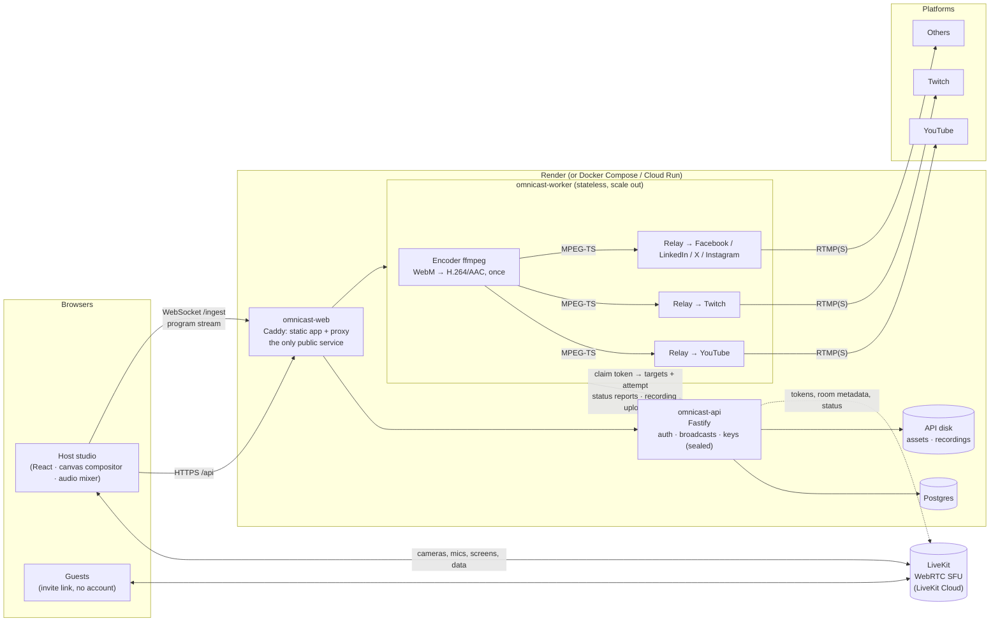

# OmniCast Studio

[](https://github.com/Yash-Kavaiya/omnicast-studio/actions/workflows/ci.yml)
[](https://render.com/deploy?repo=https://github.com/Yash-Kavaiya/omnicast-studio)

A live-streaming studio in the browser. Invite guests with a link, arrange them in layouts, share
your screen, add your brand, and stream to **YouTube, Twitch, Facebook, LinkedIn, X and Instagram
at the same time**, with a Material Design 3 interface.

It is built so that one platform failing never takes the others down: each platform gets its own
relay that reconnects by itself, and the host's connection, the workers and the API can all
restart in the middle of a show without ending it. See [How it stays live](#how-it-stays-live).

## Architecture



1. The host's browser composes the program (people, screens, banners) on a canvas, mixes the
   audio, and streams it over one WebSocket to a media worker.
2. The worker exchanges the ingest token with the API for the platforms' RTMP URLs (stream keys
   never reach a browser), encodes the program **once**, and hands the encoded stream to **one
   copy-only relay per platform**, plus the recording.
3. Status flows worker → API → studio (over the LiveKit data channel), so the host sees each
   platform's state live: connecting, live, reconnecting, failed.

More detail, the scaling table and the design decisions: [docs/ARCHITECTURE.md](docs/ARCHITECTURE.md).

## How it stays live

| What fails | What happens |
|---|---|
| **One platform drops or refuses mid-show** | Only that platform's relay restarts, after 1 s, 2 s, 4 s … up to 30 s, for as long as the show runs. The others and the recording carry on untouched. |
| **A wrong stream key** | Marked failed with the reason after 5 tries; nobody else is affected. |
| **A slow platform** | Its relay is restarted when it falls ~10 s behind, so it rejoins at live. The encoder is never held back. |
| **The host's network blips** | The browser reconnects within 25 s, and the worker keeps the platforms waiting for 30 s. Viewers see a few seconds' pause, not an ended stream. |
| **A worker is redeployed or crashes** | Browsers are told to reconnect (close code 1012) and land on a healthy instance. |
| **The reconnect lands on a different worker** | Each claim gets a higher `attempt` number; the API ignores the old worker's reports, so it cannot end the show. |
| **The API restarts** | The worker retries status reports and recording uploads with backoff. |
| **Postgres hiccups** | The pool reconnects; `/api/health` returns 503 meanwhile so the platform can route around it. |
| **Several API instances** | Migrations run under an advisory lock; one instance (lock holder) runs the daily schedule. |

Scaling out: the web and worker tiers are stateless. Add worker instances as more shows go live at
once (one 1080p30 show ≈ 2 CPU cores). The API is stateless except for its disk of uploads and
recordings; move those to object storage to scale it out too.

## Quick start (local)

You need **Node 22 or newer** and **ffmpeg** on the PATH. No Docker.

```bash
git clone https://github.com/Yash-Kavaiya/omnicast-studio.git
cd omnicast-studio
./run.sh
```

`run.sh` checks Node and ffmpeg, installs dependencies if they are missing, and starts everything.
The first run downloads the LiveKit server (about 20 MB) into `.bin/`. Then open
<http://localhost:5173>, create an account and a broadcast.

On Windows, run it from Git Bash. Without bash, the same thing is:

```bash
npm install
npm run dev
```

Install ffmpeg with `winget install Gyan.FFmpeg` (Windows), `brew install ffmpeg` (macOS) or
`apt install ffmpeg` (Linux), then open a new terminal.

### Windows (PowerShell)

- **Start:** `npm run dev`: the full stack, with the LiveKit that runs on this computer. Keep the
  window open, then open <http://localhost:5173>. Stop it with Ctrl+C.
- **Stop a stuck stack:** kill whatever is holding ports 5173, 7880, 1935, 4000 and 4100:

  ```powershell
  Get-NetTCPConnection -State Listen -LocalPort 5173,7880,1935,4000,4100 -ErrorAction SilentlyContinue |
    Select-Object -ExpandProperty OwningProcess -Unique |
    ForEach-Object { taskkill /F /T /PID $_ }
  ```

- **Start without LiveKit:** `$env:NO_LOCAL_LIVEKIT = '1'; npm run dev`. The dashboard loads, but
  opening a studio fails with "Something went wrong", because the studio needs a LiveKit room. Run
  `Remove-Item Env:NO_LOCAL_LIVEKIT` before starting normally again.

### What `run.sh` does

| Command | What it does |
|---|---|
| `./run.sh` | Install what is missing, then start the whole stack |
| `./run.sh guests` | For inviting guests: a public https address, with LiveKit Cloud carrying the media |
| `./run.sh stop` | Stop a stack that is still holding its ports |
| `./run.sh restart` | Stop, then start |
| `./run.sh check` | Typecheck, lint and unit tests |
| `./run.sh e2e` | End-to-end tests in Chrome (starts the stack if needed) |
| `./run.sh build` | Production builds |

The stack is five processes:

| Port | Process |
|---|---|
| 5173 | Web app (Vite) |
| 4000 | REST API |
| 4100 | Media worker (ffmpeg encoder and per-platform relays) |
| 7880 | LiveKit server (dev mode) |
| 1935 | Mock RTMP destination |

Every setting has a development default, so local use needs no `.env`. To change one, copy
`.env.example` to `.env`.

## Invite guests from other networks

There are two ways to run the studio, and you choose per session:

| Command | LiveKit | Use it for |
|---|---|---|
| `./run.sh` | On this computer | Streaming on your own, or with guests on your Wi-Fi. Uses no cloud allowance. |
| `./run.sh guests` | LiveKit Cloud | Sessions with guests on other networks. |

`./run.sh guests` starts the stack behind a tunnel and prints a public https address. Open the
studio at that address, not at localhost, and send guests the invite link from there.

It uses ngrok when ngrok is installed and signed in, otherwise a Cloudflare quick tunnel, which
needs no account and is downloaded on first use. Force one with `TUNNEL=ngrok ./run.sh guests` or
`TUNNEL=cloudflare ./run.sh guests`. A quick tunnel's address changes every time it starts.

The tunnel carries the web app and the API only. Camera and microphone traffic goes straight
between each browser and LiveKit, and a LiveKit running on your computer cannot be reached from
outside your network. So a guest session uses a LiveKit server on the internet. Create a LiveKit
Cloud project and put its details in `.env`:

```
GUEST_LIVEKIT_URL=wss://<your-project>.livekit.cloud
GUEST_LIVEKIT_API_KEY=<key>
GUEST_LIVEKIT_API_SECRET=<secret>
```

Only `./run.sh guests` reads these. Time spent in a guest session counts against the LiveKit
project's allowance; a normal `./run.sh` does not touch it.

## Try a stream without a real platform

Add a destination with the RTMP URL `rtmp://localhost:1935/live` and any stream key: the stack
includes a mock RTMP server there. Watch what it receives with
`ffplay rtmp://localhost:1935/live/<your-key>`.

## Go live on a real platform

Add a destination under **Destinations → Add with stream key**. The dialog says where each
platform shows its RTMP URL and key. This works for all six platforms. For YouTube the URL is
`rtmp://a.rtmp.youtube.com/live2` and the key comes from YouTube Studio. Treat a stream key like a
password: anyone who has it can stream to your channel.

For one-click connect (YouTube, Twitch, Facebook), create an OAuth app on the platform and set its
credentials in `.env` (see `.env.example`). The redirect URL to register is
`<your origin>/api/oauth/<youtube|twitch|facebook>/callback`.

## What is in the studio

- **Stage and backstage.** Everyone joins backstage; the host adds sources to the stage.
- **Layouts.** Ten of them: solo, grid, side by side, stacked, lead + guests, mosaic, spotlight,
  picture in picture, screen + sidebar, cinema.
- **Layout page.** Tune spacing, margins, corners, main-tile size, sidebar side, picture-in-picture
  corner and size, crop or fit, borders, shadow, backdrop and name-tag style. Upload a background
  picture or pick one of six built-in ones.
- **Works on phones and tablets.** The studio, the green room and the guest view rearrange for
  small screens; the controls stay fixed at the bottom.
- **Microphone options.** The arrow beside the mic button picks the microphone and speakers,
  shows a live input level, and switches noise suppression, echo cancellation and automatic
  volume. Choices are remembered in the browser.
- **Camera backgrounds.** The arrow beside the camera button offers three strengths of blur, six
  built-in backgrounds, or your own picture, for the host and for guests. They are also in the
  green room. The segmentation model is downloaded from a CDN the first time one is used.
- **A page per template.** News, Cricket and Party each have their own tab; a new broadcast can
  start from any of them.
- **Smooth transitions.** Tiles glide between layouts; people, banners, comments and holding
  screens fade in and out.
- **Auto director.** Guests go on stage as they join (up to a number you set, 3 by default), the
  layout re-arranges itself, the speaker is highlighted, and optionally moved to the main spot.
- **News room.** Anchor, interview, panel and full-screen headline scenes, with a channel bar,
  clock, headline and second line, story points and a ticker strip.
- **Daily AI news rundown.** A full show written every day at 5 PM India time, run from the News
  tab with a teleprompter; see below.
- **Cricket.** Follows a real match or is scored by hand; see below.
- **Watch party.** A queue of video files and links, a now-playing bar, polls answered in chat,
  chat reactions with a hype meter, a scoreboard, and a winner celebration; see below.
- **Holding screens.** Starting soon, Be right back, Thanks for watching. They silence the
  stream. Starting and BRB can show a countdown timer.
- **Guests.** Invite link, no account; camera and microphone check before joining. The host can
  mute or remove a guest.
- **Sharing.** Screen with audio, an image, or a video clip.
- **Brand.** Colour, logo, overlay, background and name tags.
- **Banners.** Eight kinds: lower third, name + title, social handle, call to action, ticker, top
  headline, corner badge and title card. Banners in different positions can show together, and
  there are one-click presets.
- **Music.** At the top of the Banners tab, in every template: four stings (intro, breaking,
  transition, outro) and three looping beds (headlines, soft, countdown) that the studio generates
  itself, so there is nothing to license, plus your own uploads (MP3, WAV, OGG or M4A, up to
  20 MB). Volume, fade out, and automatic lowering while someone on stage speaks. Music goes out
  on the stream and the recording and keeps playing on the holding screens. Guests in the studio
  do not hear it.
- **Chat.** Private studio chat; Twitch and YouTube comments that can be put on screen.
- **Recording.** Every stream is recorded; watch, download or share a link.
- **Themes.** Light, dark, or follow the system.

## Cricket

Choose the **Cricket** template on the Scenes tab, then open the **Cricket** tab.

A new cricket scene follows a live match: the India match if one is on, otherwise any live match.
Pick another from the match list. The score refreshes every 5 seconds and goes out with the rest
of the scene, so guests and the stream see what the host sees.

| Layout | Cameras | Score |
|---|---|---|
| Strip | Your usual layout | A score strip along the bottom |
| Corner | Fill the frame | A small score box in the top-left corner |
| Split | Left side | A tall panel: score, batters, bowler, this over, runs per over |
| Board | Column at the side | Both teams, the numbers, the crease, this over, runs per over |
| Card | Column at the side | The batting card and the bowlers, with runs per over |

**Score by hand** switches to a ball-by-ball pad (runs, wickets, wides, no-balls) for a match the
feed does not cover.

**Moments** play a cartoon banner across the middle of the frame for about four seconds: FOUR, SIX,
WICKET, FIFTY, HUNDRED and FREE HIT. They play by themselves as the score changes, live or scored
by hand (a no-ball brings up FREE HIT; a batter passing 50 or 100 brings up the milestone), and the
buttons on the Cricket tab play any of them by hand. Turn **Play moments automatically** off to
keep only the buttons. **Your own banner** shows any words you type, or a ready-made one such as
HAT-TRICK!, with an emoji and in the brand colour.

The live score comes from ESPN's public cricket feed. It is free and needs no key, but it is not a
documented API and could change or be blocked without notice. When it cannot be reached, the last
score stays on screen and the Cricket tab says so. Only the host's browser talks to the feed.

## Daily AI news rundown

Choose the **News** template on the Scenes tab, then open the **News** tab.

Every day at 5 PM India time the API collects the day's AI news and writes a show of about 15
minutes. If the stack was not running at 5 PM, it makes the rundown when it next starts after that
hour. **Generate now** makes one at any time; it takes a few minutes.

**Where the news comes from.** Hacker News, new fast-rising repositories on GitHub, trending
models and Spaces on Hugging Face, new arXiv papers, and the feeds of AI labs and tech news sites
(the list is `FEEDS` in `apps/api/src/news/sources.ts`). None needs a key. For the most-noticed
stories the article itself is read, so the script has more to go on than a headline. X has no free
API: a post on X appears only when one of those sources links to it, and you can add any link to a
story yourself.

**Who writes it.** A model ranks the items and writes the script. Set one of these in `.env`:

```
NVIDIA_API_KEY=<key from build.nvidia.com>
GEMINI_API_KEY=<key from aistudio.google.com>
```

NVIDIA is tried first (`NEWS_MODEL`, then `NEWS_FALLBACK_MODEL` when the first is busy), then
Gemini. The model may only cite the links that were collected; it cannot add its own. With no key,
or when every model fails, the rundown still has headlines, summaries and links, but no spoken
script. A script is a model's reading of the sources: skim the **Background** notes and the source
before you say a number on air.

**The show.** Opening, top story, four more stories, repo of the day, project of the day, model of
the day, paper of the day, quick hits, number of the day, and sign-off. `SHOW_NAME`, `SHOW_HOST`,
`SHOW_X`, `SHOW_GITHUB` and `SHOW_LINKEDIN` in `.env` set whose show it is; the opening and the
sign-off read them out.

**Running it.**

- Click an item, or **Start the show** and **Next**, to put it on air. Its headline, second line,
  story points and ticker go on screen.
- The **teleprompter** appears under the stage with the words to say and background notes beside
  them. Only you see it: it is not part of the stream. Space starts and pauses the scroll, the
  left and right arrows change item, up and down nudge the text.
- Each item lists its sources. **Open to share** opens the page in a new tab; share that
  tab with the screen share button. **Show card** draws the site, title and a quote on the
  stream beside you (Anchor scene, with only you on stage).
- **Add a link** attaches a post or page of your own to the item on air.
- **Full script** opens the whole show on one page, for reading ahead or printing.

## Watch party

Choose the **Watch party** template on the Scenes tab, then open the **Party** tab.

- **Queue.** Add video files (MP4 or WebM) and links, and put them in order. Files play inside the
  studio as the main picture, with pause, seek, restart and volume. They are not uploaded: they
  stay on your computer, so after a page reload each file has to be chosen again. A link (YouTube,
  X, any page) opens in a new tab. Press **Put on stage**, choose that tab in the browser's picker
  and keep "Also share tab audio" ticked: the tab goes on stage with its sound. Play and pause the
  video in that tab; **Stop** takes it off stage and closes the tab.
- **Now playing.** A bar along the top shows the title, the time played and what comes next. When
  a file ends, an "Up next" card counts down five seconds and the next file starts. Playback stops
  at a link, because a tab cannot be opened without a click.
- **Polls.** Ask a question with two to four answers. Viewers vote by typing the answer's number
  in chat, one vote each; you can add votes by hand. Closing the poll highlights the winner.
- **Reactions.** Emoji that viewers send in chat float up over the video and fill the hype meter.
  The reaction buttons do the same from the studio.
- **Scoreboard.** Add the people on stage or type names, give and take points, show the board on
  screen, and celebrate the leader with the trophy.

Votes and reactions from chat need you to be live, and come from Twitch (any Twitch destination)
and from YouTube when it is connected with one click, which needs a Google OAuth app in `.env`.
Votes by hand and the reaction buttons work without any of that.

## Commands

| Command | What it does |
|---|---|
| `npm run dev` | LiveKit, mock RTMP, API, media worker and web app |
| `npm test` | Unit and integration tests (Vitest); the worker tests run real ffmpeg |
| `npm run e2e` | End-to-end tests in Chrome (starts the stack if it is not running) |
| `npm run typecheck` / `npm run lint` | Static checks |
| `npm run build` | Production builds of all three apps |

The end-to-end tests run two browsers, an SFU and a video encoder at once. Do not run them on the
machine you are streaming from while you are live.

## Troubleshooting

- **Go live does nothing, and the destination shows "ffmpeg exited with code 3221225794".** On
  Windows this means ffmpeg could not start because the stack has lost the terminal that launched
  it. Run `./run.sh restart` in a terminal and keep that terminal open.
- **The stream fails to start for another reason.** Start the stack with `FFMPEG_LOG=1 ./run.sh`
  to print ffmpeg's full log. The log contains the stream key, so do not share it.
- **"The stack is already using its ports".** An earlier run is still alive. `./run.sh restart`.
- **You still see the old interface after an update.** Hard-refresh the tab (Ctrl+Shift+R).
- **Camera backgrounds are missing.** The browser lacks WebGL 2 or the needed video APIs; the
  menu says so. Chrome and Edge support them.

## Layout

```
apps/web            React studio and dashboard
apps/api            REST API
apps/media-worker   ffmpeg encoder and one reconnecting relay per platform
packages/shared     schemas, scene model, layout engine
packages/ui         Material 3 tokens and components
e2e/                Playwright end-to-end tests
scripts/            dev launcher, LiveKit download, mock RTMP server
infra/              Dockerfiles (render/ for Render), docker-compose.yml, Caddyfiles
render.yaml         Render Blueprint
docs/               ARCHITECTURE.md
run.sh              set up and run everything
```

## Deploy to Render

[`render.yaml`](render.yaml) is a Render Blueprint that creates the whole stack in the Singapore
region:

| Service | Type | Plan | What it is |
|---|---|---|---|
| `omnicast-web` | Web service (public) | 0.5 CPU / 512 MB | Caddy: serves the app, proxies `/api`, `/assets` and the `/ingest` WebSocket |
| `omnicast-api` | Private service | 0.5 CPU / 512 MB + 10 GB disk | REST API; uploads and recordings on its disk |
| `omnicast-worker` | Private service | 2 CPU / 4 GB | ffmpeg encoder plus one relay per platform, 1080p30 at 6000 kbit/s |
| `omnicast-db` | Render Postgres | 0.1 CPU / 256 MB | Accounts, broadcasts, sealed stream keys |

**Steps**

1. Create a free project at [LiveKit Cloud](https://cloud.livekit.io). Note its URL
   (`wss://<project>.livekit.cloud`), API key and API secret. Render cannot host LiveKit, which
   needs UDP ports for WebRTC.
2. Click **Deploy to Render** at the top of this page, or in the Render dashboard go to
   **New → Blueprint** and pick this repository.
3. When asked, enter `LIVEKIT_URL`, `LIVEKIT_API_KEY` and `LIVEKIT_API_SECRET`, or leave all three
   empty and add the project later in the app (step 5). The optional keys
   (Google OAuth, NVIDIA, Gemini) can stay empty. `SESSION_SECRET`, `ENCRYPTION_KEY` and
   `INTERNAL_SECRET` are generated by Render.
4. Wait for the four resources to go live, then open `https://omnicast-web.onrender.com`.
5. Sign up, open **Settings** and paste the LiveKit Cloud URL, API key and API secret, then
   **Test and save**. The API checks them with LiveKit before saving, keeps the secret encrypted
   and never sends it back to a browser. Each account can use its own project this way; one saved
   in Settings takes precedence over the server's `LIVEKIT_*` values.

If Render gives the web service another address (because the name is taken), set `WEB_ORIGIN`
and `PUBLIC_INGEST_URL` on `omnicast-api` to that address (`https://…` and `wss://…/ingest`).

Render redeploys every push to `main`. A deploy restarts the worker: a show that is live at that
moment pauses for a few seconds while the host's browser reconnects, and carries on.

**Smaller or larger.** On a 1 CPU worker set `ENCODE_WIDTH=1280`, `ENCODE_HEIGHT=720`,
`ENCODE_VIDEO_KBPS=4500`. For several shows at once, raise the worker's instance count. Each
instance takes any show, and a reconnect may move a show between instances safely.

### Environment variables

| Variable | Service | Purpose |
|---|---|---|
| `LIVEKIT_URL`, `LIVEKIT_API_KEY`, `LIVEKIT_API_SECRET` | api | Optional. The server's LiveKit project for cameras, guests and the data channel; accounts without their own (Settings) use it |
| `WEB_ORIGIN`, `PUBLIC_INGEST_URL` | api | The public address of `omnicast-web` |
| `SESSION_SECRET`, `ENCRYPTION_KEY`, `INTERNAL_SECRET` | api (worker reads `INTERNAL_SECRET`) | Generated; 32+ characters each |
| `DATABASE_URL` | api | From `omnicast-db` |
| `ENCODE_WIDTH`, `ENCODE_HEIGHT`, `ENCODE_FPS`, `ENCODE_VIDEO_KBPS`, `ENCODE_AUDIO_KBPS` | worker | The one encode every platform gets |
| `UPLOAD_RECORDINGS=1` | worker | Hand each recording to the API (they share no disk) |
| `GOOGLE_*`, `TWITCH_*`, `FACEBOOK_*` | api | Optional one-click platform connect |
| `NVIDIA_API_KEY`, `GEMINI_API_KEY` | api | Optional, for the daily AI news script |

### Other ways to deploy

- **One server with Docker Compose:** `infra/docker-compose.yml` runs Caddy (HTTPS), API, workers,
  Postgres, Redis and LiveKit on one host. Read the header of that file.
- **Google Cloud Run:** `.github/workflows/deploy.yml` (run by hand from the Actions tab). Cloud
  Run cuts a WebSocket after 60 minutes, so a show is reconnected once an hour.

The container files have not been built on the machine this was written on (it has no Docker).
CI runs the same production builds with npm.
